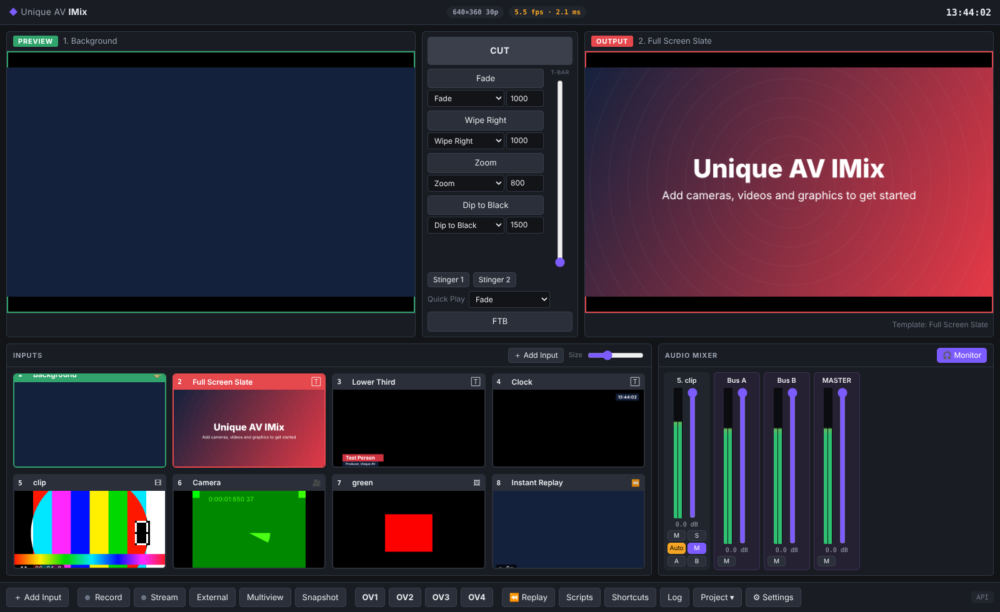

# Unique AV Streaming GuRu

**Unique AV Streaming GuRu** is a live video production switcher for macOS: mix cameras, video files, graphics and audio with transitions, overlays and titles, and record and live-stream the result. It is modelled on the workflow of Windows production switchers such as vMix, so operators who know that workflow will feel at home.

It is an Electron app. Compositing runs on the GPU (WebGL/Metal), audio mixing uses Web Audio, and FFmpeg handles streaming with Apple VideoToolbox hardware encoding.



## Features

### Inputs
| Type | Notes |
|---|---|
| **Camera / capture device** | Webcams, USB/HDMI capture cards, iPhone Continuity Camera, virtual cameras. Choose resolution, frame rate and embedded audio device. |
| **Audio input** | Microphones and audio interfaces, stereo or a single mono channel. |
| **Screen / window capture** | Picker with live thumbnails for every screen and window. |
| **Video file** | MP4, MOV (H.264/HEVC), WebM, MKV and more. Loop, auto play, auto pause and auto restart. |
| **Video list (playlist)** | Plays a list of files in order, with loop and shuffle. |
| **Image** | PNG (with alpha), JPG, GIF (animated), WebP, SVG. |
| **Audio file** | MP3, WAV, AAC, M4A, FLAC and more. |
| **Title / graphics** | 10 animated templates: Lower Third, Modern Lower Third, Headline, Ticker, Clock, Countdown, Scoreboard, Corner Bug, Plain Text and Full Screen Slate. You can change the fonts, colours and alignment. |
| **Colour** | Solid colour backgrounds. |
| **Web browser** | Any web page rendered offscreen, with transparency and custom CSS. Use it for HTML graphics and widgets. |
| **Stream URL** | Direct media URLs. |
| **Instant replay** | Shows the replay buffer as an input. |
| **Countdown Timer** | The Unique AV Countdown presenter timer as an input, with an optional transparent background for overlays. |

Add inputs from the **＋ Add Input** button or the **Input** menu, or drop files onto the inputs area. Drag tiles to reorder them.

### Every input has
* **Position:** zoom, pan, crop, fit/fill/stretch, opacity and PiP presets.
* **Colour correction:** brightness, contrast, saturation, hue and gamma.
* **Keying:** chroma key (green or blue screen, with an eyedropper, similarity, smoothness and spill reduction) and luma key.
* **Layers:** up to 4 other inputs composited on top. Use them for PiP, side-by-side, quad split or virtual sets, with optional borders.
* **Audio:** volume, trim gain, balance, sync delay, 6-band parametric EQ, compressor and noise gate. Routes to Master and Buses A–F, with mute, solo and audio-follows-video.

### Switching
* **Preview / Output** monitors with transport controls (play/pause, seek, next item).
* **Cut**, **Quick Play**, **4 configurable transition buttons** and a **T-bar**.
* **23 transitions:** Fade, Wipe (4 directions), Slide (4), Push (4), Zoom, Cross Zoom, Iris, Dip to Black, Dip to White, Dissolve, Blinds (2) and Cube. There are also **2 stingers**: video files, with alpha via WebM, and a configurable cut point.
* **4 overlay channels** with Fade, Cut, Zoom and Slide in/out effects.
* **Fade to black.**
* Tally on every tile: red when on air, green when in preview.

### Audio mixer
* A channel strip per audio input with peak meters and peak hold, fader, mute, solo, Auto (audio follows video), EQ and routing buttons for **Master and Buses A–F**.
* **7 mix buses:** Master plus six aux buses, A–F. Each has its own fader, mute, meter and EQ. Recording, streaming and the speaker monitor can each take any bus, so you can run a clean record mix, a mix-minus for remote guests and a separate stream mix at the same time.
* **6-band parametric EQ** on every input and every bus. The bands are low cut, low shelf, three bells and high shelf, and each band's type can be changed, including to high cut or notch. Click **EQ** on any strip to open the EQ window. Drag points on the frequency-response curve to set frequency and gain, scroll to change the width (Q), or type exact values. Presets: Voice / Presenter, Podcast / Broadcast, Music Bed, Low Cut, Bass Boost and Telephone. The EQ button lights up when the EQ is on. Settings are saved with the project, and older projects' 3-band EQ settings carry over.

### Outputs
* **Record** to MP4 (H.264/AAC) or WebM. Files are finalised with FFmpeg so they seek correctly.
* **Stream** to up to 3 destinations at once over RTMP, RTMPS or SRT. Presets cover YouTube, Twitch, Facebook and Restream. Encoding uses Apple VideoToolbox (hardware) or x264.
* **Unlimited outputs** (*🖥 Outputs*). Add as many as you need. Each output has its own:
  * **Source:** Program, Clean feed (program without overlays), Preview, Multiview or any single input.
  * **Destination:**
    * **Display, full screen:** any screen macOS sees, including HDMI, DisplayPort, USB-C/Thunderbolt adapters, AirPlay displays, and playout or capture devices that show up as a display.
    * **Window.**
    * **Blackmagic DeckLink / UltraStudio card:** through FFmpeg, see below.
    * **Network stream:** SRT, RTMP or UDP.
    * **Audio device only.**
  * **Audio:** any bus, sent to any audio device (audio interfaces, HDMI/SDI embedders, AirPlay speakers).
  * Outputs can start automatically with the project, and are controlled with `OutputOn`, `OutputOff`, `OutputToggle` and `SetOutputSource` from the API, Companion and shortcuts.
* **Blackmagic DeckLink / UltraStudio output** needs Blackmagic Desktop Video and an FFmpeg built with `--enable-decklink`. The bundled FFmpeg can't include DeckLink support for licensing reasons, so set the path to your own build in *Settings → Streaming*. Your cards then appear in the Outputs window. The card plays the mixer format, which must be a mode the card supports, such as 1080p25, 1080p29.97 or 1080p50. Expect around 0.3–0.5 s of latency.
* **Multiview output:** preview, program and every input with tally and labels.
* **Snapshot:** saves a PNG of the output.
* **Instant replay:** a rolling buffer of the output or any input. Play back the last N seconds in slow motion (0.1×–1×) and save Mark In/Out events.

### Slow motion
* Every video, playlist and audio-file input has a **playback speed** from 0.1× to 2×. You can choose to keep the audio pitch.
* The Preview and Output transports have a **speed menu** and a **SLOW-MO** button that switches between 1× and the input's slow-motion speed.
* API functions: `SetRate Input=… Value=0.5`, `SlowMotion` (toggle) and `SlowMotionOff`.
* For live cameras, use **Instant Replay**. It buffers the source and plays it back at 0.1×–1×.

### Custom output formats
* Any resolution from 64×64 to 8192×8192, including projector, LED-wall, vertical and DCI sizes, plus presets.
* Any frame rate from 1 to 240, including 23.976, 29.97, 59.94 and 119.88.

### Countdown timer (Unique AV Countdown, built in)
The whole [Unique AV Countdown](https://github.com/Jeansenekal-tech/UniqueAVCountdown) app runs inside Streaming GuRu. Open it with **⏱ Countdown** or ⇧⌘T. The upstream commit it came from is recorded in `countdown/UPSTREAM_COMMIT`. It includes:
* The **operator window** with its rundown: countdown, count-up and end-at-time-of-day segments, with warnings, sounds, auto-advance and a quick timer.
* The **presenter screen** on any display, with messages, flash, blackout and video PIP layouts with crop.
* The **phone remote** on port 8080, **OSC** on UDP 8000 and **MIDI**. Existing Companion, OSC and MIDI setups keep working unchanged.
* A **Countdown menu** in the menu bar.
* Your existing rundown and settings from the standalone app are imported automatically the first time.

It also connects to the mixer:
* **Countdown Timer input:** the presenter timer as a source you can cut to or use as an overlay (transparent option).
* A **top-bar timer** that turns yellow and red with the warning times.
* **API functions:** `CountdownStart`, `CountdownPause`, `CountdownToggle`, `CountdownNext`, `CountdownPrevious`, `CountdownReset`, `CountdownAdd`, `CountdownSubtract`, `CountdownGoto`, `CountdownQuick`, `CountdownMessage`, `CountdownFlash`, `CountdownHideMessage`, `CountdownBlackout`, `CountdownLayout`, `CountdownVideo` and `CountdownPresenter`. These work from the Companion vMix module, Stream Deck, shortcuts and scripts.

### Automation and remote control
* **Keyboard shortcuts.** You can fully customise them, and a learn mode captures new keys.
* **MIDI control.** Learn mode supports notes and CCs, and CCs can drive faders and the T-bar.
* **Scripting** in JavaScript, for example `await API.Function('Fade', {Input: 2})`, plus `sleep()` and `log()`.
* **HTTP API** on port 8088, for example `GET /api?Function=Cut&Input=2`. It also serves XML state at `/api`, JSON at `/api/state.json` and a live snapshot at `/api/snapshot.jpg`.
* **TCP API** on port 8099: `FUNCTION`, `XML`, `TALLY`, `SUBSCRIBE TALLY`, `SUBSCRIBE ACTS` (real-time activators) and `PING`.
* The API uses the function names and XML layout that common switcher control surfaces expect, so tools such as Bitfocus Companion and Stream Deck can drive it.
* **Web controller:** open `http://<mac-ip>:8088/` on a phone or tablet. You can switch inputs, run overlays, edit titles, mix audio and start or stop the recording and stream. LAN access and a password are configured in *Settings → Web & API*.

### Status bar
* **CPU** shows whole-system usage and, on hover, how much of it this app uses.
* **GPU** shows GPU utilisation from macOS's own graphics statistics; on hover it shows the GPU model and GPU memory in use. It works on Apple Silicon, Intel and AMD GPUs and needs no admin rights.
* **RAM** shows this app's memory use.
* **RENDER** shows the frame rate actually achieved against the target, and how much of each frame's time budget is used.
* Each meter turns amber above 60% and red above 85%.

### Automatic updates
* The app checks for new versions in the background every 4 hours and downloads them quietly. It **never restarts during a show**: a green *Restart to update* pill appears in the top bar, and if you ignore it the update installs the next time you quit.
* Each download is verified against its SHA-512 checksum before it is installed. Installation swaps the app bundle in place, so it works for signed and unsigned builds alike.
* *Settings → Updates* has *Check now*, toggles for automatic checking and background download, and a custom update URL. The app menu also has **Check for Updates…**.

### Projects
* Save and open a whole production as a `.guru` file: inputs, settings, transitions, overlays, stingers, stream destinations, shortcuts and scripts.
* The last session is restored automatically on launch.
* Output formats: 720p, 1080p, 1440p, 4K, vertical 1080×1920, square and PAL SD, at 24, 25, 30, 50 or 60 fps.

## Installing on a Mac

1. Download the `.dmg` for your Mac. Use **arm64** for Apple Silicon (M1–M4) and **x64** for Intel. Releases are on the GitHub *Releases* page. Every push also builds DMGs, which you'll find under *Actions → Build macOS app → (run) → Artifacts*.
2. Drag **Unique AV Streaming GuRu** to Applications.
3. Builds are unsigned unless you add signing certificates, so the first time you open the app, right-click it and choose **Open**. You can also run:
   ```sh
   xattr -dr com.apple.quarantine "/Applications/Unique AV Streaming GuRu.app"
   ```
4. Allow **Camera**, **Microphone** and **Screen Recording** when macOS asks. You can change these later in *System Settings → Privacy & Security*.

FFmpeg is bundled in the app. You can point to another FFmpeg build in *Settings → Streaming*, for example one installed with `brew install ffmpeg`.

## Building from source

```sh
npm install          # installs Electron, electron-builder and ffmpeg-static
npm start            # run the app
npm run dist:mac     # build .dmg + .zip into dist/ (run on a Mac)
```

Every push runs `.github/workflows/build-mac.yml`. It runs the tests and then builds Apple Silicon and Intel `.dmg` files. To sign and notarise the builds, add the `MAC_CERT_P12_BASE64`, `MAC_CERT_PASSWORD`, `APPLE_ID`, `APPLE_APP_SPECIFIC_PASSWORD` and `APPLE_TEAM_ID` repository secrets.

### Publishing a release (and auto-updates)

```sh
git tag v1.0.1 && git push origin v1.0.1
```

Pushing a `v*` tag makes the workflow build both DMGs, set the app version from the tag, and publish a GitHub Release. The release includes the `.dmg` and `.zip` files and an `update-mac.json` manifest. Installed copies find the release through `updateUrl` in `package.json`, which by default points to this repository's latest release.

> **The repository is private.** An installed app can't download from a private repository's releases. Choose one of these so auto-update can reach users:
> * make this repository public, or
> * publish releases to a separate **public** repository and point `updateUrl` in `package.json` to `https://github.com/<owner>/<public-repo>/releases/latest/download`, or
> * upload the release files (`update-mac.json`, `.zip`, `.dmg`) to any web server or S3 bucket and set `updateUrl` to that folder.
>
> You can also change the URL per machine in *Settings → Updates*.

### Tests
```sh
node test/unit-updater.mjs                  # updater version logic + release manifest
node test/unit-sysmon.mjs                   # GPU utilisation parsing
node test/countdown-engine-test.cjs         # Unique AV Countdown engine + OSC (upstream tests)
node test/browser-smoke.mjs                 # UI + engine in headless Chromium (needs playwright + ffmpeg)
xvfb-run -a node test/electron-smoke.mjs    # full app: HTTP/TCP API, recording, FFmpeg streaming, browser input
```

## Keyboard shortcuts (defaults)

| Key | Action |
|---|---|
| Space | Transition 1 |
| Enter | Cut |
| Q / W / E | Transitions 2–4 |
| 1–9 | Put that input in Preview |
| ⇧ 1–9 | Cut that input to Output |
| F1–F4 | Toggle overlay 1–4 with the Preview input |
| B | Fade to black |
| ⌘R / ⇧⌘R | Record / Stream |
| ⌘S / ⌘O | Save / Open project |

Click a tile to put it in Preview. Double-click a tile to open its settings, and right-click it for more actions.

## Bitfocus Companion and Stream Deck

The app speaks the same HTTP (8088) and TCP (8099) control protocol as vMix, so the **Companion vMix module** ("Studiocoast vMix") works with it. That includes Companion driving an Elgato Stream Deck, Stream Deck +, XL or Mini, or Companion's web buttons.

1. In *Settings → Web & API*, make sure the API is enabled. If Companion runs on a **different computer**, turn on **Allow network (LAN) access**.
2. In Companion, add the **vMix** connection. Set the host to this Mac's IP address, or `127.0.0.1` if Companion runs on the same Mac, and leave the TCP port at 8099.
3. Use the vMix actions and feedbacks as usual.

Tested against the module's own XML parser and TCP protocol:
* Program and preview tally, including tally for layered inputs.
* Overlay, record, stream, fade-to-black and external-output feedbacks.
* Input volume, mute, audio-follows-video, solo and bus routing.
* Master, Bus A and Bus B audio with level meters.
* Title text fields and `SetText`.
* Real-time activators (`SUBSCRIBE ACTS`), `PING`, and `Input=0` meaning the preview input.

Companion actions for features this app doesn't have do nothing and return an error: PTZ, MultiCorder, video calls, multi-camera replay, data sources, NDI/OMT and Mix 2–16. The full list of supported functions is under *Help → API Reference*.

**Stream Deck without Companion:** Stream Deck plugins built for vMix that send HTTP commands (`/api/?Function=…`) to port 8088 also work. Point them at this Mac's address.

## API quick reference

```
GET http://127.0.0.1:8088/api?Function=PreviewInput&Input=3
GET http://127.0.0.1:8088/api?Function=Fade&Duration=500
GET http://127.0.0.1:8088/api?Function=OverlayInput1In&Input=Lower%20Third
GET http://127.0.0.1:8088/api?Function=SetText&Input=4&SelectedName=Name&Value=Jane
GET http://127.0.0.1:8088/api?Function=SetVolume&Input=2&Value=80
GET http://127.0.0.1:8088/api?Function=StartStopRecording
GET http://127.0.0.1:8088/api                      → XML state
```

`Input` accepts an input's number, its title or its key. The full list of more than 150 functions is under *Help → API Reference* in the app.

## Architecture

```
main.js                 Electron main: windows, menus, permissions, IPC
main/protocol.js        imix:// scheme – serves the UI and local media (with Range support)
main/ffmpeg.js          FFmpeg discovery, live streaming (tee muxer → RTMP/SRT), remux
main/api-server.js      HTTP + TCP control API and web controller
main/browser-input.js   Offscreen Chromium pages for web browser inputs
main/sysmon.js          CPU / GPU / RAM monitor for the status bar
main/countdown-host.js  Hosts Unique AV Countdown (engine, windows, remote, OSC, mixer bridge)
countdown/              Unique AV Countdown sources (engine, OSC, phone remote, operator + presenter UI)
src/engine/video-outputs.js  Unlimited outputs (displays, windows, DeckLink, SRT/RTMP/UDP, audio devices)
main/updater.js         Auto-update (manifest check, verified download, bundle swap)
scripts/                Release manifest generator, ad-hoc signing hook
preload.js              window.imix bridge
src/engine/mixer.js     Production state machine + render loop (worker-timed)
src/engine/compositor.js  WebGL compositor: inputs → layers → preview/program, transitions, overlays
src/engine/gl.js        GLSL: colour correction, chroma/luma key, 11 transition shaders
src/engine/inputs.js    Input types
src/engine/audio.js     Web Audio mixer (EQ, compressor, gate, delay, buses, meters)
src/engine/titles.js    Title templates
src/engine/outputs.js   Recording, streaming, external/multiview output, snapshots
src/engine/replay.js    Instant replay buffer
src/engine/api.js       Function dispatcher + XML/JSON state
src/engine/automation.js  Shortcuts, MIDI, scripting
src/ui/*                Interface
src/web/index.html      Remote web controller
```

## Not included (yet)

vMix has had more than 15 years of development, and some of its features depend on proprietary SDKs or Windows-only drivers. These are **not** in this version:

* **Native NDI** inputs and outputs (needs the NDI SDK and a native module).
  *Workaround today:* install the free **NDI Tools for Mac** and use **NDI Virtual Input**. It turns any NDI source on your network into a camera, which you add here with *Add Input → Camera*. For NDI output, a screen-capture NDI sender can capture the External Output window (check which senders your NDI Tools version includes).
* **SRT / RTMP inputs** (receiving streams). SRT and RTMP *outputs* are supported.
* **Virtual camera output** into Zoom or Teams (needs a signed macOS camera extension).
* **Video calls** (vMix Call), **PTZ camera control**, **3D virtual sets**, **multi-camera ISO recording** (MultiCorder), a visual **title designer** (GT Designer), **VST audio plugins** and **data sources** for titles.
* Instant replay records one source at a time. vMix can record up to 8 cameras.

The engine is modular, with one class per input or output, so each of these can be added on its own later.

## Unique AV Recorder for Windows

[`windows-recorder/`](windows-recorder/) holds a separate, basic Windows recorder. It records video from capture cards and webcams, and audio from USB devices, with input gain, volume, mute and level meters. It saves to MP4, MKV, WAV or M4A. The **Build Windows recorder** workflow builds a Windows installer `.exe` and a portable `.exe`. See its [README](windows-recorder/README.md).
