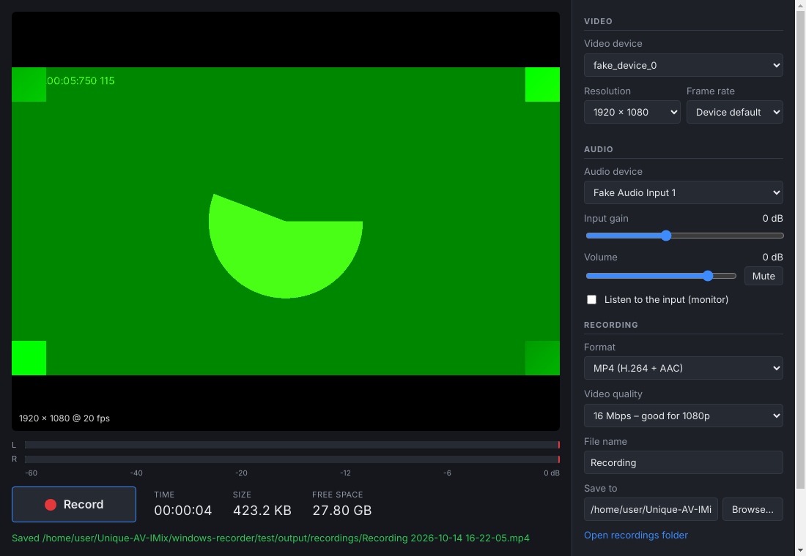

# Unique AV Recorder (Windows)

A basic video and audio recorder for Windows. It records from:

* **Capture cards:** USB and PCIe HDMI/SDI capture devices (Elgato, Magewell, AVerMedia, Blackmagic, generic USB 3.0 HDMI dongles) and webcams.
* **USB audio:** USB microphones, audio interfaces and mixers, and the embedded audio of a capture card.



## Download

You can get the `.exe` in either of two ways:

* **From a release.** Push a tag such as `recorder-v1.0.0`. The **Build Windows recorder** workflow then publishes a GitHub Release with both files below.
* **From any build.** Open the workflow run in the **Actions** tab and download the `Unique-AV-Recorder-windows` artifact.

| File | What it is |
|---|---|
| `Unique-AV-Recorder-Setup-x.y.z.exe` | Installer, with Start menu and desktop shortcuts. |
| `Unique-AV-Recorder-Portable-x.y.z.exe` | A single exe. No install is needed. |

The app isn't code-signed, so Windows SmartScreen may warn on first run. Click **More info → Run anyway**.

## Using it

1. Pick a **Video device**: your capture card or webcam. Choose **None** to record audio only.
2. Pick the **Resolution** and **Frame rate**. *Device default* uses the device's current mode. The mode the device actually delivers is shown at the bottom left of the preview.
3. Pick the **Audio device**. This can be a USB microphone or interface, or the capture card's own audio. The capture card's audio usually appears as a separate device, for example *Digital Audio Interface (USB Capture HDMI)*, and is chosen automatically the first time if Windows reports it as part of the same device.
4. Set the levels while watching the L/R meters:
   * **Input gain** (−24 to +36 dB) boosts or cuts the device's signal. Use it for quiet mics and hot line inputs.
   * **Volume** (−∞ to +12 dB) is the fader for the recording.
   * **Mute** silences the audio in the recording.
   * Double-click either slider to reset it to 0 dB. The meters show exactly what is recorded, so keep peaks out of the red.
   * Tick **Listen to the input** to monitor through your speakers or headphones.
5. Choose a **Format**, the **Video quality** (bitrate), a **File name** and the folder under **Save to**. The default folder is `Videos\Unique AV Recorder`.
6. Press **Record** or **F9**, and press it again to stop.

| Format | Notes |
|---|---|
| MP4 (H.264 + AAC) | Plays everywhere. The default. |
| MKV | Keeps the recorded streams untouched. Fastest to finish. |
| WAV (24-bit) / M4A (AAC) | Shown when no video device is selected. |

Files are named `Recording 2026-10-14 16-05-33.mp4`. Windows uses the GPU's hardware H.264 encoder when it has one.

### Crash safety

While recording, the app writes `… (raw).mkv` next to the final file. When you stop, FFmpeg turns it into the chosen format and deletes it. If the app or PC crashes, the raw file is still there. It plays in VLC, or you can convert it with FFmpeg.

## Tips for capture cards

* A capture card can only be used by one app at a time. Close OBS, Teams or the vendor's utility first.
* If the preview is black, try another **Resolution** or **Frame rate**, and check that the source isn't HDCP-protected.
* Some cards (for example Blackmagic DeckLink) need their vendor driver, so that the card appears as a webcam-style device.

## Development

```bash
cd windows-recorder
npm install
npm start                                   # run the app
npm test                                    # FFmpeg conversion tests
xvfb-run -a node test/electron-smoke.mjs    # end-to-end test with fake devices (needs playwright)
npm run dist:win                            # build the .exe (on Windows)
```

The app uses Electron. Devices are opened with `getUserMedia`, and the audio path (gain → volume/mute → meters, recording, monitor) is built with Web Audio. `MediaRecorder` records, and its chunks are streamed to disk by the main process (`main.js`). `ffmpeg.js` then finishes the file with the bundled FFmpeg (`ffmpeg-static`).
